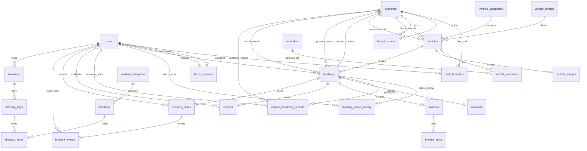

# Thiết kế database

Nguồn schema: [V1](../../backend/src/main/resources/db/migration/V1__rental_schema.sql), [V2](../../backend/src/main/resources/db/migration/V2__incident_audit_and_review_vehicle.sql), [V3](../../backend/src/main/resources/db/migration/V3__vehicle_creation_time.sql) và [V4](../../backend/src/main/resources/db/migration/V4__location_visit_metadata.sql). Flyway quản lý lịch sử migration, Hibernate validate schema. V1 định nghĩa25bảng nghiệp vụ và37FK; V3/V4 thêm cột nullable, không thêm bảng. Bảng flyway_schema_history là bảng kỹ thuật.

Không sửa migration đã áp dụng trong môi trường dùng chung. Kiểm kê history/checksum/schema trước nâng cấp; MySQL DDL có thể để lại thay đổi một phần sau lỗi. Không tự clean/repair database. Review liên kết xe thông qua booking, không thêm reviews.vehicle_id trực tiếp.

## 1. Danh sách bảng và trạng thái sử dụng

Tổng số bảng: **25 bảng nghiệp vụ** + **1 bảng kỹ thuật** (`flyway_schema_history`) = 26 bảng.
Trong đó:
- **15 bảng** có code nghiệp vụ đọc/ghi (Implementation thực tế qua Entity hoặc Sql qua JdbcTemplate).
- **2 bảng** chỉ dùng để seed/đọc catalog.
- **8 bảng** chỉ có schema (chưa có nghiệp vụ, file Java 0 byte không được tính).

| Table | Migration | PK | FK | UNIQUE/CHECK/NULL quan trọng | Mục đích | Module sở hữu | Code đang đọc/ghi | Trạng thái |
|---|---|---|---|---|---|---|---|---|
| flyway_schema_history | Flyway | do Flyway quản lý | - | Metadata lịch sử migration | Lịch sử migration | kỹ thuật | Flyway | Bảng kỹ thuật |
| users | V1 | id (VARCHAR) | - | UNIQUE(email), CHECK(role), CHECK(status) | Tài khoản | user | Có | Đã dùng |
| branches | V1 | id (VARCHAR) | - | CHECK(status) | Chi nhánh | branch | Có | Đã dùng |
| staff_branches | V1 | user_id, branch_id | user_id, branch_id | - | Phân công nhân viên | branch | Có (JdbcTemplate) | Đã dùng |
| branch_routes | V1 | id (VARCHAR) | pickup_branch_id, return_branch_id | UNIQUE(pickup, return), CHECK(fee>=0) | Tuyến nhận trả | branch | Có | Đã dùng |
| vehicle_brands | V1 | id (VARCHAR) | - | UNIQUE(name) | Hãng xe | vehicle | Không (Seed) | Catalog |
| vehicle_categories | V1 | id (VARCHAR) | - | UNIQUE(name) | Loại xe | vehicle | Không (Seed) | Catalog |
| vehicles | V1 | id (VARCHAR) | brand_id, category_id, home_branch_id, current_branch_id | UNIQUE(plate), CHECK(seats), CHECK(transmission) | Xe | vehicle | Có | Đã dùng |
| amenities | V1 | id (VARCHAR) | - | UNIQUE(name) | Tiện nghi | vehicle | Không | Chỉ schema |
| vehicle_amenities | V1 | vehicle_id, amenity_id | vehicle_id, amenity_id | - | Liên kết xe-tiện nghi | vehicle | Không | Chỉ schema |
| vehicle_images | V1 | id (VARCHAR) | vehicle_id | UNIQUE(vehicle_id, sort_order) | Ảnh xe | vehicle | Không | Chỉ schema |
| driver_licenses | V1 | id (VARCHAR) | user_id, checked_by | UNIQUE(user_id), CHECK(scheme, status) | Giấy phép lái xe | user | Có | Đã dùng |
| bookings | V1 | id (VARCHAR) | user_id, vehicle_id, pickup_branch_id, return_branch_id, actual_return_branch_id | CHECK(start<end), CHECK(price/days>0) | Đơn đặt xe | booking | Có | Đã dùng |
| booking_status_history | V1 | id (VARCHAR) | booking_id, actor_id | - | Lịch sử trạng thái đơn | booking | Có (JdbcTemplate) | Đã dùng |
| vehicle_handover_records | V1 | id (VARCHAR) | booking_id, actor_id, branch_id | UNIQUE(booking_id, kind), CHECK(kind) | Biên bản giao nhận | operation | Có (JdbcTemplate) | Đã dùng |
| contracts | V1 | id (VARCHAR) | booking_id | UNIQUE(booking_id) | Hợp đồng | contract | Có (JdbcTemplate) | Đã dùng |
| invoices | V1 | id (VARCHAR) | booking_id | UNIQUE(booking_id), CHECK(total>=0) | Hóa đơn | invoice | Có (JdbcTemplate) | Đã dùng |
| invoice_items | V1 | id (VARCHAR) | invoice_id | CHECK(quantity, unit_price, amount) | Chi tiết hóa đơn | invoice | Có (JdbcTemplate) | Đã dùng |
| reviews | V1 | id (VARCHAR) | booking_id, moderated_by | UNIQUE(booking_id), CHECK(rating 1-5) | Đánh giá | review | Có (JdbcTemplate) | Đã dùng |
| incident_cases | V1 | id (VARCHAR) | booking_id, reported_by | CHECK(kind, status, amount>=0) | Hồ sơ sự cố | operation | Có | Đã dùng |
| incident_events | V1 | id (VARCHAR) | case_id, actor_id | V2 đề xuất thêm cột; trạng thái áp dụng chưa xác minh | Nhật ký sự cố | operation | Có (JdbcTemplate) | Đã dùng |
| location_categories | V1 | id (VARCHAR) | - | UNIQUE(name) | Phân loại địa điểm | location | Không | Chỉ schema |
| locations | V1/V4 | id (VARCHAR) | category_id | CHECK(lat, long); visit_metadata TEXT nullable | Địa điểm và metadata tham quan có kiểu | location | Có | Admin CRUD, USER đọc ACTIVE |
| itineraries | V1 | id (VARCHAR) | user_id | - | Lịch trình người dùng | ai/itinerary | Không | Chỉ schema |
| itinerary_days | V1 | id (VARCHAR) | itinerary_id | UNIQUE(itinerary_id, trip_date) | Ngày trong lịch trình| ai/itinerary | Không | Chỉ schema |
| itinerary_items | V1 | id (VARCHAR) | day_id, location_id | UNIQUE(day_id, sort_order) | Điểm đến | ai/itinerary | Không | Chỉ schema |

## 2. Quan hệ database

### A. Phạm vi và trạng thái

- Bảng nghiệp vụ V1: **25**; bảng kỹ thuật Flyway: **1**; FK V1: **37**. V2 không tạo bảng mới. Các số đếm được kiểm lại từ DDL, không lấy theo báo cáo trước.
- Trong 25 bảng: 15 có code đọc/ghi, 2 catalog chỉ seed/đọc, 8 chỉ có schema. AI/itinerary tables tồn tại nhưng chưa chứng minh AI đã triển khai; quyết định là làm AI sau core nghiệp vụ.
- Cách đọc quan hệ: `1-N`/`1-0..1` mô tả số bản ghi con tối đa; cột “Bắt buộc/tùy chọn” nói FK ở **bảng con** có `NOT NULL` hay cho phép `NULL`. FK bắt buộc không có nghĩa cha bắt buộc phải có con. DDL không ghi `ON DELETE/UPDATE`; với InnoDB mặc định là `RESTRICT`/`NO ACTION`, không phải chính sách xóa đã được thiết kế riêng.
- Vị trí `V1:n` là số dòng trong migration V1 được liên kết phía trên. Các FK liệt kê dưới đây là toàn bộ 37 FK từ V1; không tính ý định FK V2.

### B. Bảng quan hệ — FK thực thi trong V1

| Bảng cha | Bảng con | Quan hệ | Bắt buộc/tùy chọn (FK con) | Khóa/ràng buộc | Giải thích nghiệp vụ; bằng chứng |
|---|---|---|---|---|---|
| `users.id` | `staff_branches.user_id` | 1-N | Bắt buộc | FK; PK ghép `(user_id, branch_id)` | Một tài khoản có thể được phân công nhiều chi nhánh; bảng không tự buộc role phải là STAFF. V1:13-16 |
| `branches.id` | `staff_branches.branch_id` | 1-N | Bắt buộc | FK; PK ghép `(user_id, branch_id)` | Một chi nhánh có thể có nhiều Staff. V1:13-16 |
| `branches.id` | `branch_routes.pickup_branch_id` | 1-N | Bắt buộc | FK; UNIQUE cặp nhận/trả | Chi nhánh là điểm nhận của các tuyến được khai báo. V1:18-23 |
| `branches.id` | `branch_routes.return_branch_id` | 1-N | Bắt buộc | FK; UNIQUE cặp nhận/trả | Chi nhánh là điểm trả của các tuyến được khai báo. V1:18-23 |
| `vehicle_brands.id` | `vehicles.brand_id` | 1-N | Bắt buộc | FK | Xe thuộc một hãng. V1:25-34 |
| `vehicle_categories.id` | `vehicles.category_id` | 1-N | Bắt buộc | FK | Xe thuộc một loại xe. V1:26-34 |
| `branches.id` | `vehicles.home_branch_id` | 1-N | Bắt buộc | FK | Chi nhánh quản lý/gốc của xe, khác vị trí hiện tại. V1:27-34 |
| `branches.id` | `vehicles.current_branch_id` | 1-N | Bắt buộc | FK | Vị trí xe hiện tại. V1:27-34 |
| `vehicles.id` | `vehicle_amenities.vehicle_id` | 1-N | Bắt buộc | FK; PK ghép với `amenity_id` | Một cạnh của quan hệ nhiều-nhiều xe–tiện nghi qua bảng nối. V1:39-41 |
| `amenities.id` | `vehicle_amenities.amenity_id` | 1-N | Bắt buộc | FK; PK ghép với `vehicle_id` | Một cạnh của quan hệ nhiều-nhiều xe–tiện nghi qua bảng nối. V1:39-41 |
| `vehicles.id` | `vehicle_images.vehicle_id` | 1-N | Bắt buộc | FK; UNIQUE `(vehicle_id, sort_order)` | Ảnh thuộc xe; thứ tự ảnh không trùng trong cùng xe. Cột `attribution` giữ thông tin ghi công nguồn ảnh. V1:43-45 |
| `users.id` | `driver_licenses.user_id` | 1-0..1 | Bắt buộc | FK; UNIQUE `user_id` | Mỗi hồ sơ GPLX thuộc một tài khoản; tài khoản có thể chưa khai báo GPLX. V1:47-52 |
| `users.id` | `driver_licenses.checked_by` | 1-N | Tùy chọn | FK nullable | Người kiểm tra GPLX; có thể chưa được xác minh. V1:47-52 |
| `users.id` | `bookings.user_id` | 1-N | Bắt buộc | FK | Tài khoản đặt đơn. Không có role Guest trong bảng `users`; CHECK role chỉ nhận USER/STAFF/ADMIN. V1:1-7,55-65 |
| `vehicles.id` | `bookings.vehicle_id` | 1-N | Bắt buộc | FK | Xe được đặt trong đơn. V1:55-65 |
| `branches.id` | `bookings.pickup_branch_id` | 1-N | Bắt buộc | FK | Nơi nhận dự kiến. V1:55-66 |
| `branches.id` | `bookings.return_branch_id` | 1-N | Bắt buộc | FK | Nơi trả dự kiến. V1:55-66 |
| `branches.id` | `bookings.actual_return_branch_id` | 1-N | Tùy chọn | FK nullable | Nơi trả thực tế; source gán lúc trả, nhưng DDL không ràng buộc thời điểm cập nhật. V1:55-67; BookingService.java:89 |
| `bookings.id` | `booking_status_history.booking_id` | 1-N | Bắt buộc | FK | Lịch sử chuyển trạng thái riêng với trạng thái hiện tại của đơn. V1:75-78 |
| `users.id` | `booking_status_history.actor_id` | 1-N | Tùy chọn | FK nullable | Tác nhân đổi trạng thái có thể vắng mặt. V1:75-78 |
| `bookings.id` | `vehicle_handover_records.booking_id` | 1-N (tối đa 2 theo `kind`) | Bắt buộc | FK; UNIQUE `(booking_id, kind)`; `kind` HANDOVER/RETURN | Biên bản giao/nhận; mỗi loại tối đa một bản ghi cho một đơn. V1:80-85 |
| `users.id` | `vehicle_handover_records.actor_id` | 1-N | Bắt buộc | FK | Người thao tác giao/nhận. V1:80-85 |
| `branches.id` | `vehicle_handover_records.branch_id` | 1-N | Bắt buộc | FK | Chi nhánh nơi lập biên bản. V1:80-85 |
| `bookings.id` | `contracts.booking_id` | 1-0..1 | Bắt buộc | FK; UNIQUE `booking_id` | Đơn có thể chưa có hợp đồng; UNIQUE chỉ giới hạn tối đa một hợp đồng, không bắt buộc phải tạo. V1:87-89 |
| `bookings.id` | `invoices.booking_id` | 1-0..1 | Bắt buộc | FK; UNIQUE `booking_id` | Đơn có thể chưa có hóa đơn; hóa đơn không chứng minh đã thanh toán. V1:91-93 |
| `invoices.id` | `invoice_items.invoice_id` | 1-N | Bắt buộc | FK | Các khoản mục thuộc hóa đơn. V1:95-98 |
| `bookings.id` | `reviews.booking_id` | 1-0..1 | Bắt buộc | FK; UNIQUE `booking_id` | Tối đa một đánh giá gắn với một đơn. V1:100-104 |
| `users.id` | `reviews.moderated_by` | 1-N | Tùy chọn | FK nullable | Người kiểm duyệt; đánh giá chưa duyệt không có người kiểm duyệt. V1:100-104 |
| `bookings.id` | `incident_cases.booking_id` | 1-N | Bắt buộc | FK | Hồ sơ sự cố gắn đơn nhưng có trạng thái/vòng đời riêng. V1:106-112 |
| `users.id` | `incident_cases.reported_by` | 1-N | Bắt buộc | FK | Người lập báo cáo sự cố. V1:106-112 |
| `incident_cases.id` | `incident_events.case_id` | 1-N | Bắt buộc | FK | Nhật ký thao tác của hồ sơ sự cố. V1:116-119 |
| `users.id` | `incident_events.actor_id` | 1-N | Bắt buộc | FK | Tài khoản thực hiện thao tác được ghi nhận. V1:116-119 |
| `location_categories.id` | `locations.category_id` | 1-N | Bắt buộc | FK | Danh mục của điểm tham quan; không phải chi nhánh giao nhận. V1:121-125 |
| `users.id` | `itineraries.user_id` | 1-N | Bắt buộc | FK | Lịch trình lưu cho tài khoản. V1:127-129 |
| `itineraries.id` | `itinerary_days.itinerary_id` | 1-N | Bắt buộc | FK; UNIQUE `(itinerary_id, trip_date)` | Các ngày của lịch trình, mỗi ngày không trùng ngày khác trong cùng lịch trình. V1:131-133 |
| `itinerary_days.id` | `itinerary_items.day_id` | 1-N | Bắt buộc | FK; UNIQUE `(day_id, sort_order)` | Các mục theo thứ tự trong một ngày. V1:135-138 |
| `locations.id` | `itinerary_items.location_id` | 1-N | Bắt buộc | FK | Điểm tham quan được tham chiếu bởi mục lịch trình. V1:135-138 |

### C. ERD — cùng tập 37 FK của bảng trên

Chú giải: `||` = đúng một cha; `o|` = 0 hoặc 1 cha (FK nullable); `o{` = 0..N con. FK `NOT NULL` và `UNIQUE` bổ sung giới hạn như ghi ở bảng. Mỗi nét ERD tương ứng đúng một FK V1; M:N xe–tiện nghi chỉ thể hiện qua `vehicle_amenities`. Sơ đồ là **schema V1 đã đối chiếu tĩnh**, không chứng minh migration chạy thành công hoặc runtime đã nghiệm thu. `flyway_schema_history` là bảng kỹ thuật nên không vẽ trong ERD nghiệp vụ. Không vẽ cạnh `vehicles`–`reviews`: V1 chỉ liên kết review với booking; cạnh dự kiến từ V2 chưa hợp lệ.

V2 bổ sung các trường trạng thái và căn cứ đánh giá vào incident_events. Review tham chiếu booking; xe được suy ra từ booking, không có FK reviews.vehicle_id trực tiếp.
