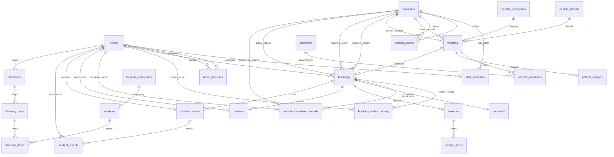

# Giai đoạn 3 — Thiết kế database và bảng quan hệ gửi giảng viên (04/10/2026)

Ngày khảo sát: 04/10/2026. Baseline HEAD: `3a8596b0543c95c261fce989d357f58c887e1648` (khớp bàn giao Antigravity). Schema V1 tại [`V1__rental_schema.sql`](../../backend/src/main/resources/db/migration/V1__rental_schema.sql), SHA-256 `AD47ABF767E24D2D37074F16786B89B65EE38908DD4F9847ABC5498AFA50E3B6`; V2 tại [`V2__incident_audit_and_review_vehicle.sql`](../../backend/src/main/resources/db/migration/V2__incident_audit_and_review_vehicle.sql), SHA-256 `7444CB4DADB9499D1EF9C8433E3F7E969F48D00E785578021201816553FA66CE`. Hai hash đều khớp bàn giao.

V1 khai báo **25 bảng nghiệp vụ, 37 FK** (đếm trực tiếp từ DDL; báo cáo Antigravity ghi 30 FK nên số liệu đó sai), cộng 1 bảng kỹ thuật `flyway_schema_history` do Flyway quản lý. Phân loại tĩnh từ source: 15 bảng có code đọc/ghi (JPA hoặc SQL), 2 bảng catalog dùng seed/đọc, 8 bảng chỉ có schema; phát hiện 22 file Java main 0 byte. Đây là tình trạng source/schema, không phải nghiệm thu runtime. Chưa kiểm tra dữ liệu trong MySQL thực tế.

**Cảnh báo migration:** V2 có FK `reviews.vehicle_id BIGINT` tham chiếu `vehicles.id VARCHAR(36)`, không tương thích (MySQL báo lỗi 3780). Chưa nghiệm thu được một lần nâng cấp hoàn chỉnh; các DDL trước câu lệnh lỗi có thể đã được MySQL áp dụng riêng lẻ, nên không giả định V2 rollback toàn bộ hoặc runtime không có thay đổi một phần. Không chạy/sửa migration trong lần rà soát này. Xem thêm [audit kiến trúc mới nhất](../architecture/system-architecture.md#nghiệm-thu-độc-lập-sau-hai-lượt-agent--29092026).

## 1. Danh sách bảng và trạng thái sử dụng

Tổng số bảng: **25 bảng nghiệp vụ** + **1 bảng kỹ thuật** (`flyway_schema_history`) = 26 bảng.
Trong đó:
- **15 bảng** có code nghiệp vụ đọc/ghi (Implementation thực tế qua Entity hoặc Sql qua JdbcTemplate).
- **2 bảng** chỉ dùng để seed/đọc catalog.
- **8 bảng** chỉ có schema (chưa có nghiệp vụ, file Java 0 byte không được tính).

| Table | Migration | PK | FK | UNIQUE/CHECK/NULL quan trọng | Mục đích | Module sở hữu | Code đang đọc/ghi | Trạng thái |
|---|---|---|---|---|---|---|---|---|
| flyway_schema_history | Flyway | do Flyway quản lý | - | Metadata lịch sử migration | Lịch sử migration | kỹ thuật | Flyway | Bảng kỹ thuật |
| users | V1 | id (VARCHAR) | - | UNIQUE(email), CHECK(role), CHECK(status) | Tài khoản | user | Có | Đã dùng |
| branches | V1 | id (VARCHAR) | - | CHECK(status) | Chi nhánh | branch | Có | Đã dùng |
| staff_branches | V1 | user_id, branch_id | user_id, branch_id | - | Phân công nhân viên | branch | Có (JdbcTemplate) | Đã dùng |
| branch_routes | V1 | id (VARCHAR) | pickup_branch_id, return_branch_id | UNIQUE(pickup, return), CHECK(fee>=0) | Tuyến nhận trả | branch | Có | Đã dùng |
| vehicle_brands | V1 | id (VARCHAR) | - | UNIQUE(name) | Hãng xe | vehicle | Không (Seed) | Catalog |
| vehicle_categories | V1 | id (VARCHAR) | - | UNIQUE(name) | Loại xe | vehicle | Không (Seed) | Catalog |
| vehicles | V1 | id (VARCHAR) | brand_id, category_id, home_branch_id, current_branch_id | UNIQUE(plate), CHECK(seats), CHECK(transmission) | Xe | vehicle | Có | Đã dùng |
| amenities | V1 | id (VARCHAR) | - | UNIQUE(name) | Tiện nghi | vehicle | Không | Chỉ schema |
| vehicle_amenities | V1 | vehicle_id, amenity_id | vehicle_id, amenity_id | - | Liên kết xe-tiện nghi | vehicle | Không | Chỉ schema |
| vehicle_images | V1 | id (VARCHAR) | vehicle_id | UNIQUE(vehicle_id, sort_order) | Ảnh xe | vehicle | Không | Chỉ schema |
| driver_licenses | V1 | id (VARCHAR) | user_id, checked_by | UNIQUE(user_id), CHECK(scheme, status) | Giấy phép lái xe | user | Có | Đã dùng |
| bookings | V1 | id (VARCHAR) | user_id, vehicle_id, pickup_branch_id, return_branch_id, actual_return_branch_id | CHECK(start<end), CHECK(price/days>0) | Đơn đặt xe | booking | Có | Đã dùng |
| booking_status_history | V1 | id (VARCHAR) | booking_id, actor_id | - | Lịch sử trạng thái đơn | booking | Có (JdbcTemplate) | Đã dùng |
| vehicle_handover_records | V1 | id (VARCHAR) | booking_id, actor_id, branch_id | UNIQUE(booking_id, kind), CHECK(kind) | Biên bản giao nhận | operation | Có (JdbcTemplate) | Đã dùng |
| contracts | V1 | id (VARCHAR) | booking_id | UNIQUE(booking_id) | Hợp đồng | contract | Có (JdbcTemplate) | Đã dùng |
| invoices | V1 | id (VARCHAR) | booking_id | UNIQUE(booking_id), CHECK(total>=0) | Hóa đơn | invoice | Có (JdbcTemplate) | Đã dùng |
| invoice_items | V1 | id (VARCHAR) | invoice_id | CHECK(quantity, unit_price, amount) | Chi tiết hóa đơn | invoice | Có (JdbcTemplate) | Đã dùng |
| reviews | V1 | id (VARCHAR) | booking_id, moderated_by | UNIQUE(booking_id), CHECK(rating 1-5) | Đánh giá | review | Có (JdbcTemplate) | Đã dùng |
| incident_cases | V1 | id (VARCHAR) | booking_id, reported_by | CHECK(kind, status, amount>=0) | Hồ sơ sự cố | operation | Có | Đã dùng |
| incident_events | V1 | id (VARCHAR) | case_id, actor_id | V2 đề xuất thêm cột; trạng thái áp dụng chưa xác minh | Nhật ký sự cố | operation | Có (JdbcTemplate) | Đã dùng |
| location_categories | V1 | id (VARCHAR) | - | UNIQUE(name) | Phân loại địa điểm | location | Không | Chỉ schema |
| locations | V1 | id (VARCHAR) | category_id | CHECK(lat, long) | Địa điểm tham quan | location | Không | Chỉ schema |
| itineraries | V1 | id (VARCHAR) | user_id | - | Lịch trình người dùng | ai/itinerary | Không | Chỉ schema |
| itinerary_days | V1 | id (VARCHAR) | itinerary_id | UNIQUE(itinerary_id, trip_date) | Ngày trong lịch trình| ai/itinerary | Không | Chỉ schema |
| itinerary_items | V1 | id (VARCHAR) | day_id, location_id | UNIQUE(day_id, sort_order) | Điểm đến | ai/itinerary | Không | Chỉ schema |

**Lưu ý V2:** Migration V2 có ý định thêm `reviews.vehicle_id` nhưng dùng kiểu `BIGINT` tham chiếu đến `vehicles.id` `VARCHAR(36)`. Lỗi này chặn migration hoàn tất. Trong tài liệu này, `reviews.vehicle_id` không được coi là FK hợp lệ; do chưa truy vấn từng database, không kết luận các DDL trước lỗi chắc chắn chưa được áp dụng một phần. Các cột audit sự cố của V2 cũng chưa được nghiệm thu.

## 2. Bảng quan hệ database gửi giảng viên

### A. Phạm vi và trạng thái

- Bảng nghiệp vụ V1: **25**; bảng kỹ thuật Flyway: **1**; FK V1: **37**. V2 không tạo bảng mới. Các số đếm được kiểm lại từ DDL, không lấy theo báo cáo trước.
- Trong 25 bảng: 15 có code đọc/ghi, 2 catalog chỉ seed/đọc, 8 chỉ có schema. AI/itinerary tables tồn tại nhưng chưa chứng minh AI đã triển khai; quyết định là làm AI sau core nghiệp vụ.
- Đây là đối chiếu thiết kế với source hiện có, **chưa nghiệm thu schema runtime**: không chạy migration, không truy cập dữ liệu MySQL, chưa có kiểm thử MySQL concurrency/E2E. V2 đang là blocker như cảnh báo đầu tài liệu.
- Cách đọc quan hệ: `1-N`/`1-0..1` mô tả số bản ghi con tối đa; cột “Bắt buộc/tùy chọn” nói FK ở **bảng con** có `NOT NULL` hay cho phép `NULL`. FK bắt buộc không có nghĩa cha bắt buộc phải có con. DDL không ghi `ON DELETE/UPDATE`; với InnoDB mặc định là `RESTRICT`/`NO ACTION`, không phải chính sách xóa đã được thiết kế riêng.
- Vị trí `V1:n` là số dòng trong migration V1 được liên kết phía trên. Các FK liệt kê dưới đây là toàn bộ 37 FK từ V1; không tính ý định FK V2.

### B. Bảng quan hệ — FK thực thi trong V1

| Bảng cha | Bảng con | Quan hệ | Bắt buộc/tùy chọn (FK con) | Khóa/ràng buộc | Giải thích nghiệp vụ; bằng chứng |
|---|---|---|---|---|---|
| `users.id` | `staff_branches.user_id` | 1-N | Bắt buộc | FK; PK ghép `(user_id, branch_id)` | Một tài khoản có thể được phân công nhiều chi nhánh; bảng không tự buộc role phải là STAFF. V1:13-16 |
| `branches.id` | `staff_branches.branch_id` | 1-N | Bắt buộc | FK; PK ghép `(user_id, branch_id)` | Một chi nhánh có thể có nhiều Staff. V1:13-16 |
| `branches.id` | `branch_routes.pickup_branch_id` | 1-N | Bắt buộc | FK; UNIQUE cặp nhận/trả | Chi nhánh là điểm nhận của các tuyến được khai báo. V1:18-23 |
| `branches.id` | `branch_routes.return_branch_id` | 1-N | Bắt buộc | FK; UNIQUE cặp nhận/trả | Chi nhánh là điểm trả của các tuyến được khai báo. V1:18-23 |
| `vehicle_brands.id` | `vehicles.brand_id` | 1-N | Bắt buộc | FK | Xe thuộc một hãng. V1:25-34 |
| `vehicle_categories.id` | `vehicles.category_id` | 1-N | Bắt buộc | FK | Xe thuộc một loại xe. V1:26-34 |
| `branches.id` | `vehicles.home_branch_id` | 1-N | Bắt buộc | FK | Chi nhánh quản lý/gốc của xe, khác vị trí hiện tại. V1:27-34 |
| `branches.id` | `vehicles.current_branch_id` | 1-N | Bắt buộc | FK | Vị trí xe hiện tại. V1:27-34 |
| `vehicles.id` | `vehicle_amenities.vehicle_id` | 1-N | Bắt buộc | FK; PK ghép với `amenity_id` | Một cạnh của quan hệ nhiều-nhiều xe–tiện nghi qua bảng nối. V1:39-41 |
| `amenities.id` | `vehicle_amenities.amenity_id` | 1-N | Bắt buộc | FK; PK ghép với `vehicle_id` | Một cạnh của quan hệ nhiều-nhiều xe–tiện nghi qua bảng nối. V1:39-41 |
| `vehicles.id` | `vehicle_images.vehicle_id` | 1-N | Bắt buộc | FK; UNIQUE `(vehicle_id, sort_order)` | Ảnh thuộc xe; thứ tự ảnh không trùng trong cùng xe. Cột `attribution` giữ thông tin ghi công nguồn ảnh. V1:43-45 |
| `users.id` | `driver_licenses.user_id` | 1-0..1 | Bắt buộc | FK; UNIQUE `user_id` | Mỗi hồ sơ GPLX thuộc một tài khoản; tài khoản có thể chưa khai báo GPLX. V1:47-52 |
| `users.id` | `driver_licenses.checked_by` | 1-N | Tùy chọn | FK nullable | Người kiểm tra GPLX; có thể chưa được xác minh. V1:47-52 |
| `users.id` | `bookings.user_id` | 1-N | Bắt buộc | FK | Tài khoản đặt đơn. Không có role Guest trong bảng `users`; CHECK role chỉ nhận USER/STAFF/ADMIN. V1:1-7,55-65 |
| `vehicles.id` | `bookings.vehicle_id` | 1-N | Bắt buộc | FK | Xe được đặt trong đơn. V1:55-65 |
| `branches.id` | `bookings.pickup_branch_id` | 1-N | Bắt buộc | FK | Nơi nhận dự kiến. V1:55-66 |
| `branches.id` | `bookings.return_branch_id` | 1-N | Bắt buộc | FK | Nơi trả dự kiến. V1:55-66 |
| `branches.id` | `bookings.actual_return_branch_id` | 1-N | Tùy chọn | FK nullable | Nơi trả thực tế; source gán lúc trả, nhưng DDL không ràng buộc thời điểm cập nhật. V1:55-67; BookingService.java:89 |
| `bookings.id` | `booking_status_history.booking_id` | 1-N | Bắt buộc | FK | Lịch sử chuyển trạng thái riêng với trạng thái hiện tại của đơn. V1:75-78 |
| `users.id` | `booking_status_history.actor_id` | 1-N | Tùy chọn | FK nullable | Tác nhân đổi trạng thái có thể vắng mặt. V1:75-78 |
| `bookings.id` | `vehicle_handover_records.booking_id` | 1-N (tối đa 2 theo `kind`) | Bắt buộc | FK; UNIQUE `(booking_id, kind)`; `kind` HANDOVER/RETURN | Biên bản giao/nhận; mỗi loại tối đa một bản ghi cho một đơn. V1:80-85 |
| `users.id` | `vehicle_handover_records.actor_id` | 1-N | Bắt buộc | FK | Người thao tác giao/nhận. V1:80-85 |
| `branches.id` | `vehicle_handover_records.branch_id` | 1-N | Bắt buộc | FK | Chi nhánh nơi lập biên bản. V1:80-85 |
| `bookings.id` | `contracts.booking_id` | 1-0..1 | Bắt buộc | FK; UNIQUE `booking_id` | Đơn có thể chưa có hợp đồng; UNIQUE chỉ giới hạn tối đa một hợp đồng, không bắt buộc phải tạo. V1:87-89 |
| `bookings.id` | `invoices.booking_id` | 1-0..1 | Bắt buộc | FK; UNIQUE `booking_id` | Đơn có thể chưa có hóa đơn; hóa đơn không chứng minh đã thanh toán. V1:91-93 |
| `invoices.id` | `invoice_items.invoice_id` | 1-N | Bắt buộc | FK | Các khoản mục thuộc hóa đơn. V1:95-98 |
| `bookings.id` | `reviews.booking_id` | 1-0..1 | Bắt buộc | FK; UNIQUE `booking_id` | Tối đa một đánh giá gắn với một đơn. V1:100-104 |
| `users.id` | `reviews.moderated_by` | 1-N | Tùy chọn | FK nullable | Người kiểm duyệt; đánh giá chưa duyệt không có người kiểm duyệt. V1:100-104 |
| `bookings.id` | `incident_cases.booking_id` | 1-N | Bắt buộc | FK | Hồ sơ sự cố gắn đơn nhưng có trạng thái/vòng đời riêng. V1:106-112 |
| `users.id` | `incident_cases.reported_by` | 1-N | Bắt buộc | FK | Người lập báo cáo sự cố. V1:106-112 |
| `incident_cases.id` | `incident_events.case_id` | 1-N | Bắt buộc | FK | Nhật ký thao tác của hồ sơ sự cố. V1:116-119 |
| `users.id` | `incident_events.actor_id` | 1-N | Bắt buộc | FK | Tài khoản thực hiện thao tác được ghi nhận. V1:116-119 |
| `location_categories.id` | `locations.category_id` | 1-N | Bắt buộc | FK | Danh mục của điểm tham quan; không phải chi nhánh giao nhận. V1:121-125 |
| `users.id` | `itineraries.user_id` | 1-N | Bắt buộc | FK | Lịch trình lưu cho tài khoản. V1:127-129 |
| `itineraries.id` | `itinerary_days.itinerary_id` | 1-N | Bắt buộc | FK; UNIQUE `(itinerary_id, trip_date)` | Các ngày của lịch trình, mỗi ngày không trùng ngày khác trong cùng lịch trình. V1:131-133 |
| `itinerary_days.id` | `itinerary_items.day_id` | 1-N | Bắt buộc | FK; UNIQUE `(day_id, sort_order)` | Các mục theo thứ tự trong một ngày. V1:135-138 |
| `locations.id` | `itinerary_items.location_id` | 1-N | Bắt buộc | FK | Điểm tham quan được tham chiếu bởi mục lịch trình. V1:135-138 |

### C. ERD — cùng tập 37 FK của bảng trên

Chú giải: `||` = đúng một cha; `o|` = 0 hoặc 1 cha (FK nullable); `o{` = 0..N con. FK `NOT NULL` và `UNIQUE` bổ sung giới hạn như ghi ở bảng. Mỗi nét ERD tương ứng đúng một FK V1; M:N xe–tiện nghi chỉ thể hiện qua `vehicle_amenities`. Sơ đồ là **schema V1 đã đối chiếu tĩnh**, không chứng minh migration chạy thành công hoặc runtime đã nghiệm thu. `flyway_schema_history` là bảng kỹ thuật nên không vẽ trong ERD nghiệp vụ. Không vẽ cạnh `vehicles`–`reviews`: V1 chỉ liên kết review với booking; cạnh dự kiến từ V2 chưa hợp lệ.

### D. Giải thích lựa chọn và trạng thái kiểm tra

- **Guest và tài khoản:** Guest là actor chưa đăng nhập, không phải role hay bản ghi `users`. DB giới hạn role thành USER/STAFF/ADMIN; `staff_branches` gắn tài khoản với chi nhánh nhưng FK không ép role STAFF. Service `BranchService` kiểm tra role khi phân công và kiểm tra chi nhánh khi xử lý; đây là kiểm tra ứng dụng, không phải ràng buộc FK (V1:1-7,13-16; [BranchService.java](../../backend/src/main/java/com/carrental/modules/branch/service/BranchService.java#L23)).
- **Chi nhánh:** `home_branch_id`, `current_branch_id`, `pickup_branch_id`, `return_branch_id`, `actual_return_branch_id` biểu diễn năm vai trò riêng. `branches` dành cho vận hành/giao nhận; `locations` dành cho điểm tham quan. `branch_routes` lưu cặp tuyến và phí, nhưng bookings không có FK tới route: service kiểm tra tuyến đang mở ([BranchService.java](../../backend/src/main/java/com/carrental/modules/branch/service/BranchService.java#L18), [BookingService.java](../../backend/src/main/java/com/carrental/modules/booking/service/BookingService.java#L43)). Code hiện ghi nơi trả thực tế bằng chi nhánh trả đã đặt ([BookingService.java](../../backend/src/main/java/com/carrental/modules/booking/service/BookingService.java#L89)); chưa hỗ trợ đổi điểm trả giữa chuyến, theo [quyết định nghiệp vụ](../architecture/decisions.md#baseline-nghiệp-vụ-đã-duyệt-ngày-28092026).
- **GPLX:** Schema giữ scheme, hạng, hộp số hạn chế, ngày hết hạn và người kiểm tra; DB không thể hiện FK GPLX trực tiếp từ booking, cũng không xác minh tương thích với xe. `LicensePolicy` so scheme/hạng theo tổ hợp transmission/seats/hạn đến hết chuyến, không suy thứ bậc từ tên hạng; service kiểm tra khi đặt/xác nhận và Staff phải xác nhận thực tế khi giao ([LicensePolicy.java](../../backend/src/main/java/com/carrental/modules/user/service/LicensePolicy.java#L6), [LicenseService.java](../../backend/src/main/java/com/carrental/modules/user/service/LicenseService.java#L17), [BookingService.java](../../backend/src/main/java/com/carrental/modules/booking/service/BookingService.java#L43)). Audit giao diện mới nhất ghi Staff actions/GPLX chưa hiển thị đúng; chưa coi toàn luồng là nghiệm thu.
- **Lịch đặt:** DB chỉ có `start_at < end_at`, index lịch và FK; không có UNIQUE/exclusion constraint chống khoảng thời gian chồng lấn. Service khóa xe rồi áp dụng kiểm tra lịch/chuỗi chi nhánh ([BookingService.java](../../backend/src/main/java/com/carrental/modules/booking/service/BookingService.java#L35)), nhưng audit đánh dấu thứ tự khóa/race chưa được xác minh; chưa chạy concurrency trên MySQL. Vì vậy không tuyên bố chống đặt trùng đã được bảo đảm chỉ nhờ FK/UNIQUE.
- **Đơn và hồ sơ:** `booking_status_history` lưu chuyển trạng thái; biên bản có loại giao/nhận, chi nhánh, thời điểm và snapshot GPLX; hợp đồng/hóa đơn có snapshot, invoice có items. FK/UNIQUE không bảo đảm state transition, thời điểm phát hành hay nội dung snapshot đúng; các điều đó thuộc service/use case ([BookingService.java](../../backend/src/main/java/com/carrental/modules/booking/service/BookingService.java#L97), [ContractService.java](../../backend/src/main/java/com/carrental/modules/contract/service/ContractService.java#L11), [InvoiceService.java](../../backend/src/main/java/com/carrental/modules/invoice/service/InvoiceService.java#L10)).
- **Đánh giá/V2:** Đánh giá V1 liên kết booking; code hiện lấy xe qua booking ([ReviewService.java](../../backend/src/main/java/com/carrental/modules/review/service/ReviewService.java#L13)). V2 thêm vehicle_id trực tiếp nhưng sai kiểu và code không ghi cột đó (audit N01/N06 ở [audit mới nhất](../architecture/system-architecture.md#nghiệm-thu-độc-lập-sau-hai-lượt-agent--29092026)). Khuyến nghị **không rollback toàn bộ V2 một cách mù quáng, cũng không chỉ sửa kiểu rồi coi xong**: giữ V1 làm baseline; trước phát hành, tạm rút V2 khỏi triển khai cho đến khi xác nhận nhu cầu. Review hiện đã lấy xe qua booking và chưa ghi `vehicle_id`, nên chỉ giữ FK trực tiếp nếu giảng viên chấp thuận nhu cầu; khi giữ phải dùng `VARCHAR(36)` và đồng bộ service/backfill/test. Nếu V2 đã chạy ở bất kỳ DB nào, kiểm kê schema/history từng DB và dùng migration tiến/repair có kiểm soát, không xóa migration hoặc giả định rollback. Đây là khuyến nghị xin duyệt, chưa phải quyết định chốt.
- **Sự cố/bồi thường:** `occurred_at` và `reported_at` tách biệt; hồ sơ sự cố có status/events riêng. Service cho báo sau khi đơn đã giao/trả/hoàn tất nhưng kiểm tra thời điểm hiện chỉ chặn trước lúc bắt đầu và trong tương lai, chưa chặn sau thời gian giữ xe thực tế; báo muộn không chứng minh sự việc xảy ra muộn ([IncidentService.java](../../backend/src/main/java/com/carrental/modules/operation/service/IncidentService.java#L21), audit L01). Các cột số tiền có CHECK không âm; service yêu cầu căn cứ, giới hạn khoản yêu cầu sau chi trả bên khác và cần Admin gửi yêu cầu ([IncidentService.java](../../backend/src/main/java/com/carrental/modules/operation/service/IncidentService.java#L37)). Đây không phải kết luận trách nhiệm pháp lý và không có căn cứ tự trừ cọc.
- **JdbcTemplate và 22 file rỗng:** Dùng `JdbcTemplate` tự thân không đồng nghĩa vi phạm ranh giới; nhưng SQL trực tiếp trong service bỏ qua persistence boundary JPA/repository của dự án, và truy vấn xuyên module là vi phạm module boundary. Ví dụ `ReviewService` JOIN bảng `bookings` do booking sở hữu; `BranchService` đọc trực tiếp bảng `users` để xác thực phân công ([module boundaries](../architecture/module-boundaries.md), [ReviewService.java](../../backend/src/main/java/com/carrental/modules/review/service/ReviewService.java#L17), [BranchService.java](../../backend/src/main/java/com/carrental/modules/branch/service/BranchService.java#L37), [ContractService.java](../../backend/src/main/java/com/carrental/modules/contract/service/ContractService.java#L8), [InvoiceService.java](../../backend/src/main/java/com/carrental/modules/invoice/service/InvoiceService.java#L6)). Hướng xử lý: chỉ tạo Entity/Repository có triển khai cho bảng được nghiệp vụ sử dụng; chuyển truy vấn vào repository/adapter của module sở hữu, giao tiếp qua service/DTO nội bộ có kiểu. Không sinh 22 stub hoặc ép mọi bảng schema-only thành chức năng; chọn giải pháp persistence theo hướng JPA đã duyệt, chỉ giữ JDBC có chủ đích trong adapter khi có lý do.
- **Xóa:** FK không ghi CASCADE nên mặc định InnoDB từ chối xóa cha còn được tham chiếu. Điều đó không tự quyết định phải soft delete. Source chưa có luồng delete được phát hiện; `users`, `branches`, `vehicles` có trạng thái khóa/ngừng hoạt động nhưng chưa có cờ `deleted`. Đề xuất vận hành là ngừng hoạt động/ẩn với dữ liệu giao dịch và chỉ hard-delete dữ liệu không tham chiếu theo chính sách lưu trữ được duyệt; chưa chốt chính sách xóa.
- **AI:** `itineraries`, `itinerary_days`, `itinerary_items` chỉ chứng minh schema đã dự trù. Audit ghi AI/Map chưa triển khai; phù hợp quyết định triển khai AI sau backend core (AD-13 trong [decisions](../architecture/decisions.md)).

### E. Câu hỏi xin giảng viên góp ý

1. Review có cần lưu `vehicle_id` trực tiếp hay quan hệ review–booking hiện tại đã đủ, để quyết định phần này của V2?
2. Nên quy định lưu trữ/ẩn mềm/xóa cứng tài khoản, xe và hồ sơ giao dịch theo thời hạn nào?
3. Phạm vi snapshot và chứng cứ cần lưu cho hợp đồng, hóa đơn, biên bản giao nhận và hồ sơ sự cố ở mức đồ án nên đến đâu?

**Kết luận:** Tài liệu đủ làm **bản thiết kế xin góp ý**, chưa phải xác nhận schema đã áp dụng hay nghiệm thu runtime. Giữ nguyên thông tin ghi công ảnh trong `vehicle_images.attribution`; các audit/QA lịch sử ở tài liệu khác không bị thay đổi trong lần chỉnh sửa này.

## 3. Kết quả schema của agent triển khai (04/10/2026)

Nghiệm thu độc lập xác nhận fresh/V1 upgrade trên MySQL cô lập, 26 bảng/37 FK và fixture bảo toàn, nhưng **Giai đoạn 5 chưa hoàn tất**. Partial-V2 bị chặn, không clean/repair; lịch sử DB khác chưa rõ nên nâng cấp các môi trường đó **BLOCKED**. Review liên kết qua booking → vehicle đã được người dùng chốt; câu hỏi review ở mục E phía trên là lịch sử. Xem [biên bản nghiệm thu độc lập](../architecture/system-architecture.md) và `.runtime/codex-acceptance-20261004/{flyway-history.txt,migration-schema.txt,upgrade-preservation.txt,partial-history.txt}`. Không suy từ schema PASS ra concurrency/rollback/toàn hệ thống PASS.

- Schema V1 (V1__rental_schema.sql): SHA-256 AD47ABF767E24D2D37074F16786B89B65EE38908DD4F9847ABC5498AFA50E3B6.
- Schema V2 (V2__incident_audit_and_review_vehicle.sql): SHA-256 7FEF7125D7FB266435BA8D8FAEB75A4C014C3DDCC4D54068BEB74ADECD7EE94D.
- Toàn bộ 26 bảng (25 bảng nghiệp vụ + lyway_schema_history) và 37 FK đã được kiểm chứng tính nhất quán giữa cơ sở dữ liệu tạo mới (fresh) và cơ sở dữ liệu nâng cấp từ V1 có sẵn dữ liệu fixture (phase5-v1-data.sql).
- Đánh giá (reviews) tham chiếu xe thông qua quan hệ ookings.vehicle_id, không tạo cột FK trực tiếp trên 
eviews.
- Bảng incident_events lưu đầy đủ các snapshot nghiệp vụ: previous_status, 
ext_status, ssessed_damage, 	hird_party_coverage, 
equested_amount, 
esponsibility_basis.
